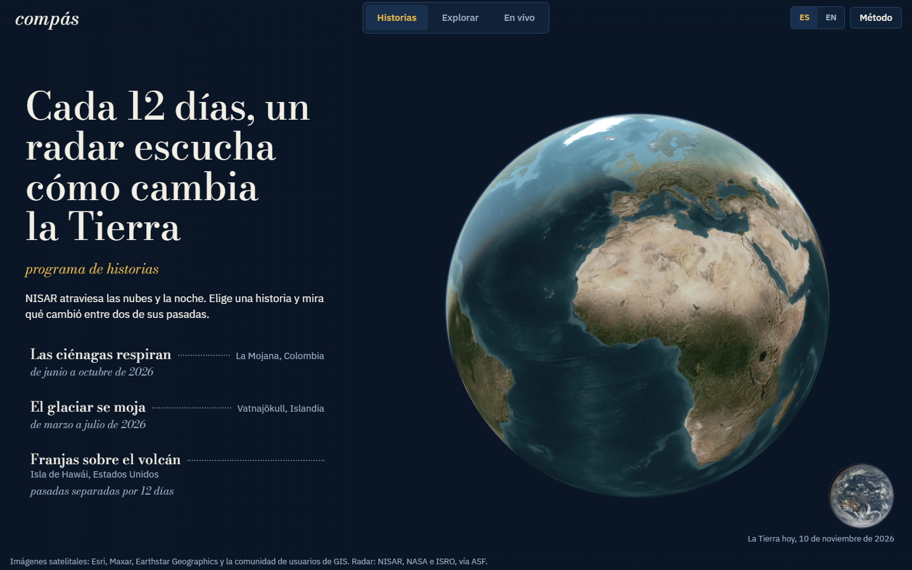
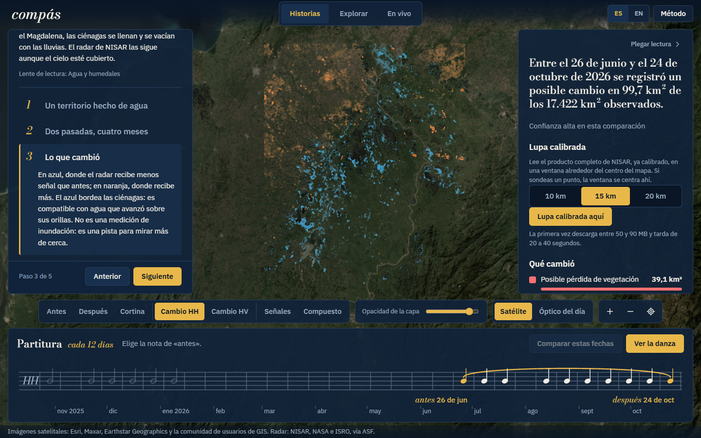
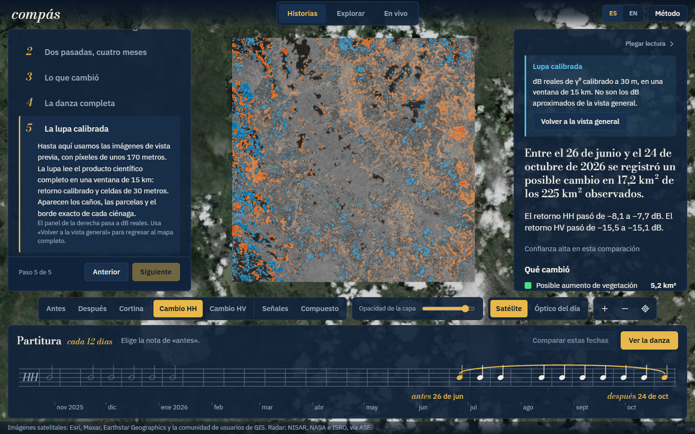
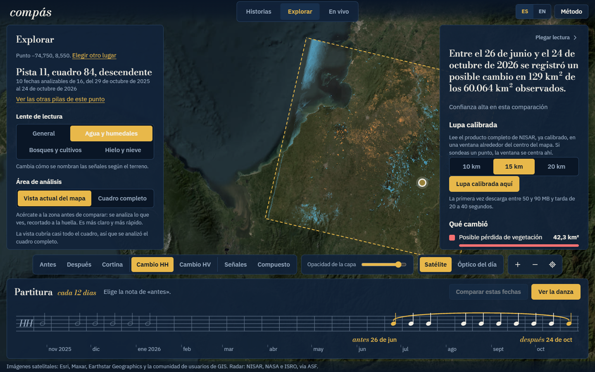

[English](README.md) · **Español**

# SARitmo

Aplicación interactiva para el reto "Dancing with the SARs" del NASA Space Apps Challenge 2026. Muestra, con datos reales del radar NISAR (NASA e ISRO), qué cambió en la superficie de la Tierra entre dos pasadas del satélite, en cualquier lugar donde haya adquisiciones.

El ciclo nominal de NISAR es de 12 días; las adquisiciones disponibles pueden tener huecos. Ese es el compás de la danza, y por eso la línea de tiempo es una partitura: cada observación es una nota y se muestra el intervalo real entre fechas.

**Nuevo recorrido guardado:** `/?demo=mojana`, con ventana calibrada, escucha HH/HV, ficha de evidencia e informe HTML imprimible. Ver [preparación, prueba sin servicios externos y recuperación del respaldo](docs/demo.md) y [estado de las mejoras](docs/estado-mejoras-2026-11-14.md).



## Qué hace

- **Historias.** Cuatro recorridos guiados con datos reales: las ciénagas de La Mojana (Colombia) entre junio y octubre de 2026, las parcelas agrícolas del valle de San Joaquín (Estados Unidos) entre el verano y la cosecha, el deshielo de verano del casquete Vatnajökull (Islandia) y los interferogramas sobre la isla de Hawái.
- **Por qué cambió.** Cada clase de cambio trae su hipótesis física, otras causas posibles y la polarización que la revela.
- **Contexto.** Capas opcionales de NASA que se encienden con un clic sobre la barra del mapa: agua superficial vista por Sentinel-1 (otro radar, de banda C), bosques y cobertura del suelo, y densidad de población. La leyenda de cada capa encendida queda a la vista.
- **Explorar.** Un clic en cualquier punto del globo, o el nombre de una ciudad o una dirección, consulta el catálogo de NASA, lista las series de pasadas que cubren ese punto y permite comparar dos fechas.
- **Lectura del cambio.** Mapa de aumento y disminución del retorno del radar, clases de cambio con su área en km², sonda por punto, histograma, procedencia de cada dato y límites del análisis.
- **La danza.** Animación a color de todas las pasadas de una serie (lila donde domina HH, verde donde domina HV), con la partitura siguiendo el ritmo. Cada nota suena a la altura a la que está dibujada: más retorno del radar, más aguda. El altavoz de la partitura (o la tecla M) lo apaga.
- **Lupa calibrada.** Con un token de Earthdata, lee una ventana del producto científico completo desde la nube de NASA. Obtiene el espaciado de los metadatos y promedia en potencia; el caso preparado de La Mojana tiene celdas de 30 m.
- **En vivo.** Eventos naturales recientes de NASA EONET, las últimas adquisiciones de respuesta urgente de NISAR, con acceso directo a explorar cada lugar, y «NISAR ahora»: el satélite en 3D, a escala, en su posición de este instante, la franja de más de 240 km que su radar alcanza a ver a la izquierda del rumbo y el recorrido de su próxima vuelta, calculados con los elementos orbitales de CelesTrak. La franja se comprobó contra la huella real de una pasada sobre La Mojana.
- **Recorrido guiado.** Unos ocho minutos en cuatro capítulos que avanzan solos, con pausa: el satélite pieza por pieza (modelo en 3D que se puede girar), cómo funciona el radar (órbita, mirada de lado, eco, superficies, HH y HV, con esquemas animados), cómo leer los datos (Antes y Después, cortina, Cambio HH y HV, Señales, Compuesto, lectura, medición de un punto y las tres capas de contexto) y cómo se usa la aplicación. Mientras explica, la aplicación hace lo que cuenta. Se abre desde «Recorrido» en la barra superior, la portada, «NISAR ahora» o la ayuda.
- **Modelo de NISAR.** Construido pieza por pieza sobre las vistas frontal y lateral que publica NASA/JPL (dominio público) y sus medidas: reflector de 12 m con aro de 30 tramos, brazo de 9 m, bus con la estructura del radar de ocho caras (5,5 m de largo), alimentadores de banda L y S, alas solares de 5,5 m y antena de banda Ka. La NASA no ofrece un modelo 3D descargable de NISAR; los soportes y detalles menores son aproximados.
- **Unidades.** En español, sistema métrico. En inglés, las medidas del satélite y de su órbita van en pies y millas; los datos científicos (km², dB) se dejan como los entrega NISAR.
- **Fronteras y nombres.** Fronteras de países, límites de departamentos o estados y nombres con su punto, dibujados sobre los datos. Se quitan y se ponen desde la barra superior (teclas B y N).
- **Ayuda y atajos.** El botón de ayuda (tecla ?) explica el uso en tres pasos y lista los atajos de teclado. Una pista sobre el mapa indica el paso siguiente en cada vista y se puede ocultar.
- Interfaz en inglés y español. Abre en inglés; el idioma se cambia en la barra superior (o con `#lang=es` en el enlace) y la elección se recuerda. Cada vista tiene un enlace permanente.







## Datos

| Fuente | Uso | Acceso |
|---|---|---|
| NISAR GCOV, imágenes de vista previa (ASF DAAC) | Cambio entre fechas en todo el cuadro, a unos 170 m por píxel | Público |
| NISAR GCOV, producto HDF5 (ASF DAAC) | Lupa calibrada: γ⁰ a 10 m, promediado a 30 m | Token de Earthdata |
| NISAR GUNW, imágenes de vista previa | Interferogramas | Público |
| NISAR Urgent Response | Adquisiciones más recientes | Público |
| NASA CMR | Catálogo: fechas, huellas, pistas y cuadros | Público |
| NASA EONET v3 | Eventos naturales | Público |
| NASA EPIC (DSCOVR) | Imagen diaria de la Tierra | Clave de api.nasa.gov |
| NASA GIBS, VIIRS | Mapa base óptico del día | Público |
| NASA GIBS, OPERA DSWx-S1 | Agua superficial vista por Sentinel-1 (banda C): contraste independiente | Público |
| NASA GIBS, MODIS IGBP | Cobertura del suelo | Público |
| NASA GIBS, GPW 2020 | Densidad de población | Público |
| Esri World Imagery | Mapa base satelital | Público |
| OpenStreetMap Nominatim | Buscador de ciudades y direcciones en Explorar | Público |
| CelesTrak (elementos orbitales de NISAR, NORAD 65053) | Posición del satélite en «NISAR ahora», calculada con el modelo SGP4 | Público |
| Natural Earth | Fronteras, límites internos y nombres sobre el mapa (archivos en `public/ref/`) | Dominio público |

No se usan datos sintéticos. Todo lo que aparece en pantalla viene de estos servicios. El buscador de lugares solo traduce un nombre a coordenadas; los datos de radar siguen siendo los de NISAR.

### Recursos del reto

El reto propone catorce recursos abiertos. Esta tabla dice qué papel tiene cada uno en SARitmo; la misma lista está en el diálogo Método de la aplicación.

| Recurso | Papel en SARitmo |
|---|---|
| [Earthdata Search](https://search.earthdata.nasa.gov/search) | Mismo catálogo (CMR) que consulta el backend para listar pasadas |
| [ASF Data Search](https://search.asf.alaska.edu/) | Origen de los productos NISAR; cada comparación enlaza a la ficha de sus dos productos |
| [Documentación de NISAR](https://nisar-docs.asf.alaska.edu/) | Especificación de GCOV y GUNW; citada en las historias |
| [Fundamentos de teledetección](https://www.earthdata.nasa.gov/learn/earth-observation-data-basics/remote-sensing) | Lectura de referencia |
| [Qué es un radar de apertura sintética](https://www.earthdata.nasa.gov/learn/earth-observation-data-basics/sar) | Base de las hipótesis físicas: bandas, polarización, interferometría |
| [Capacitaciones ARSET](https://appliedsciences.nasa.gov/get-involved/training) | Cursos para profundizar, incluidos dos con NISAR |
| [StoryMaps de NISAR](https://nisar.jpl.nasa.gov/applications/arcgis-storymaps/) | Contexto de las historias: inundaciones, hielo, hundimiento |
| [Beneficios sociales de NISAR](https://nisar.jpl.nasa.gov/applications/societal-benefit/) | Lectura de fondo por aplicación |
| [Postales de UAVSAR](https://uavsar.jpl.nasa.gov/education/postcards.html) | Antecedente aéreo en banda L; dos postales coinciden con historias (Kilauea y Vatnajökull) |
| [RCM](https://donnees-data.asc-csa.gc.ca/en/dataset/rcm) (CSA) | Referencia: radar de banda C para contrastar. No se procesa en la aplicación |
| [Tutorial de SAR](https://github.com/asc-csa/Synthetic_Aperture_Radar_Tutorial) (CSA) | Referencia para abrir imágenes RADARSAT en QGIS y Python |
| [Archivo de RADARSAT-1](https://donnees-data.asc-csa.gc.ca/en/dataset/radarsat1) (CSA) | Referencia: banda C de 1995 a 2013. No se procesa en la aplicación |
| [Catálogo SAOCOM](https://catalogos.conae.gov.ar/catalogo/catalogoSatSaocomInfo.html) (CONAE) | Referencia: banda L, como NISAR. No se procesa en la aplicación |
| [Acceso al archivo SAOCOM](https://www.argentina.gob.ar/noticias/la-informacion-saocom-cada-vez-mas-accesible) (CONAE) | Condiciones de acceso: registro y licencia, solo territorio argentino |

## Método

El análisis general parte de las imágenes de vista previa que NASA publica con cada producto GCOV. Esas imágenes no guardan el retorno calibrado: cada una se recorta entre sus propios percentiles 5 y 95 y lleva una corrección gamma de 0,5. Lo confirmamos en el código fuente de `nisarqa` y en los metadatos de control de calidad de cada producto. Dos fechas, por tanto, no se pueden restar directamente.

SARitmo hace lo siguiente:

1. Invierte la gamma para obtener una magnitud proporcional a la potencia.
2. Suaviza el moteado con una media de 5×5 píxeles.
3. Ajusta una fecha a la escala de la otra con una regresión robusta de eje mayor reducido sobre los píxeles no saturados.
4. Recorta ambas fechas al intervalo en que las dos tienen información.
5. Calcula el cambio en decibelios aproximados y lo clasifica con un umbral de 3 dB.

El resultado es el cambio relativo al conjunto de la escena, no un valor calibrado. La aplicación dice "dB aproximados" y rotula cada clase como "posible". Informa por separado calidad del ajuste, cobertura de datos y respaldo de la interpretación: un buen ajuste no confirma una inundación.

La lupa calibrada lee γ⁰ del producto GCOV y calcula `10·log10(γ⁰₂/γ⁰₁)` sin ajuste global. Sigue sujeta a geometría, ruido, cobertura y ambigüedad física. La regla de posible vegetación inundada exige HH ≥ +3 dB y HV entre −1,5 y +1,5 dB, además de HH antes no oscuro; una caída fuerte de HV ya no satisface esta regla.

### Validación

La ejecución del 14 de noviembre de 2026 compara tres combinaciones de zona y fechas, HH/HV y umbrales de 2, 3 y 4 dB. Para la ventana principal de 15 km de La Mojana (26 de junio a 24 de octubre de 2026, 7.744 píxeles comunes), HH a 3 dB:

| Referencia | Correlación | Mediana de error absoluto | Precisión | Exhaustividad |
|---|---|---|---|---|
| Agregada a ~170 m | 0,517 | 0,78 dB | 50,0 % | 12,2 % |
| Media adicional 5×5 (~1 km) | 0,861 | 0,69 dB | 12,5 % | 45,0 % |

En la segunda fila coinciden 9 de 72 detecciones browse y 20 de referencia: el 100 % de signo correcto se refiere solo a esos 9 aciertos. En otra ventana, HH da correlación 0,471 a la escala suavizada y ninguna coincidencia al umbral. La pareja de fechas consecutivas tiene pocos cambios fuertes y no permite estimar precisión cuando no hay detecciones. Correlación no equivale a exactitud de detección; los píxeles suavizados no son muestras independientes y GCOV no es verdad de terreno. Las clases físicas siguen sin validación independiente. Consulta [todos los resultados y límites](docs/validacion-ampliada.md) y el [JSON reproducible](docs/validacion-multiventana-2026-11-14.json). Se conservan los resultados históricos.

El detalle del método y de cada servicio está en `docs/contrato-api.md`.

### Cómo comprobar un resultado por tu cuenta

- **Procedencia.** Cada comparación lista el nombre de los dos productos. Búscalos en https://search.asf.alaska.edu y verás las mismas imágenes publicadas por NASA.
- **Control temporal.** Compara pasadas seguidas y revisa si hay evidencia externa de estabilidad. Doce días también pueden contener cambios reales.
- **Dos órbitas.** Revisa el mismo periodo desde ambas geometrías si hay datos; las diferencias de observación pueden cambiar la respuesta. La coincidencia es evidencia adicional, no una condición garantizada.
- **Otro radar.** Activa la capa de agua de Sentinel-1 y compárala con el cambio de NISAR.
- **Otro sensor.** Revisa las mismas fechas en imágenes ópticas en https://worldview.earthdata.nasa.gov.
- **Dato calibrado.** Abre la lupa sobre la zona, o ejecuta `scripts/validar_browse_vs_gcov.py`.
- **Terreno.** Ninguna de estas comprobaciones reemplaza la información de campo: niveles de ríos, reportes locales, censos agrícolas.

### Lo que la herramienta no afirma

- No confirma inundaciones, incendios, deforestación ni deformación del terreno. Señala dónde cambió el retorno del radar y con qué es compatible.
- No es un sistema de alertas.
- Un interferograma sin corregir no mide deformación: la atmósfera y la ionosfera también dejan franjas.
- Solo compara fechas del mismo modo de adquisición. Mezclar modos produce franjas falsas.

## Cómo ejecutarlo

Requisitos: Python 3.11 o posterior, Node.js 20 o posterior, y conexión a internet.

```powershell
git clone https://github.com/Gxxrazn21/compas-nisar
cd compas-nisar

# 1. Claves (opcionales): copia la plantilla y complétala
Copy-Item .env.example .env

# 2. Instala, compila y abre http://127.0.0.1:8000
powershell -ExecutionPolicy Bypass -File scripts\start.ps1 -Prewarm
```

`-Prewarm` descarga y calcula las cuatro historias antes de abrir, para que respondan al instante durante una presentación.

Las dos claves de `.env` son opcionales:

- `NASA_API_KEY` (gratis en https://api.nasa.gov) activa la imagen diaria de la Tierra en la portada.
- `EARTHDATA_TOKEN` (gratis en https://urs.earthdata.nasa.gov/profile, pestaña Generate Token) activa la lupa calibrada. Caduca a los 60 días.

Sin ellas funciona todo lo demás. Ninguna clave llega al navegador: el servidor hace las peticiones.

### Modo desarrollo

```powershell
python -m pip install -r requirements.txt
npm install
python -m uvicorn backend.main:app --port 8000   # API
npm run dev                                      # interfaz en http://127.0.0.1:5173
```

### Pruebas

```powershell
python -X utf8 -m unittest discover -s tests   # backend, sin red
npm test                                       # interfaz
python -X utf8 scripts\smoke_backend.py        # backend contra los servicios reales
```

### Atajos de teclado

| Tecla | Acción |
|---|---|
| 1, 2, 3 | Historias, Explorar, En vivo |
| ← → | Paso anterior o siguiente de la historia |
| D | Empezar la danza o salir de ella |
| Espacio | Pausar o reanudar la danza |
| M | Sonido de las notas |
| B, N | Fronteras, nombres |
| + − 0 | Acercar, alejar, volver al área |
| ? | Ayuda |

Los atajos no actúan mientras se escribe en un campo.

### Datos de referencia del mapa

`public/ref/` guarda las fronteras, los límites internos y los nombres, ya simplificados. Para regenerarlos desde Natural Earth (necesita `shapely`):

```powershell
python -X utf8 scripts\build_reference.py
```

## Video explicativo

La carpeta `video/` genera un video de 92 segundos (1920 × 1080) que muestra la aplicación en uso, en inglés y en español. No usa capturas a mano: graba la aplicación real con Chrome y la monta sobre una composición animada.

```powershell
# Con la aplicación corriendo en http://127.0.0.1:8000
node video\capture.mjs en          # graba las tomas de la aplicación (repite con "es")
python -X utf8 video\music.py      # pista de fondo, generada por síntesis
node video\render.mjs en --audio video\out\music.wav   # video\out\compas-en.mp4
```

Necesita Google Chrome y ffmpeg. Los textos y los tiempos de cada escena están en `video/composition/script.js`. Las tomas y los MP4 no se versionan.

## Estructura

```
backend/    API FastAPI: catálogo, imágenes, método de cambio, series, lupa calibrada, eventos
src/        Interfaz React + TypeScript + MapLibre GL
data/       Historias (stories.json) y caché local (no se versiona)
docs/       Contrato de la API, dirección de diseño, validación y capturas
scripts/    Lanzador, precálculo, pruebas de humo, validación y prototipos
video/      Video explicativo: grabación de la app, composición animada y render
tests/      Pruebas del backend
```

La caché de `data/cache/` se limita sola a unos 3,5 GB; se puede borrar en cualquier momento.

## Uso de inteligencia artificial

El código y los textos de este proyecto se escribieron con asistentes de programación (Codex y Claude Code), dirigidos y revisados por el autor. Los asistentes no generaron ningún dato: las imágenes, cifras y fechas provienen de los servicios de NASA y ASF citados arriba, y cada resultado se puede reproducir con los scripts del repositorio.

## Licencia

Código bajo licencia MIT (ver `LICENSE`). Los datos pertenecen a sus fuentes y se usan según sus políticas de acceso abierto.

## Créditos

Datos de NISAR por cortesía de NASA, ISRO y el Alaska Satellite Facility DAAC. Eventos de NASA EONET. Imagen diaria de NASA EPIC. Teselas de NASA GIBS y de Esri (Esri, Maxar, Earthstar Geographics y la comunidad de usuarios de GIS). Búsqueda de lugares con Nominatim, © colaboradores de OpenStreetMap. Elementos orbitales de NISAR de CelesTrak; posición calculada con satellite.js (SGP4). Modelo en 3D de NISAR hecho con three.js a partir de las láminas de NASA/JPL. Fronteras y nombres de Natural Earth (dominio público). Proyecto independiente: no es un producto oficial de NASA ni de ISRO.

## English summary

SARitmo is an interactive web app for the "Dancing with the SARs" challenge. It uses real NISAR observations to explore radar return changes wherever acquisitions exist. Its musical score represents dated observations, with selectable HH/HV and explicit gaps. A saved La Mojana walkthrough includes a calibrated GCOV window, a manual evidence review and a portable HTML brief. The overview uses normalized preview imagery: agreement with calibrated GCOV varies by window, date, channel and scale. In the main 15 km HH case, correlation at the smoothed scale is 0.861 but precision at 3 dB is only 12.5%, with 9 joint detections out of 72 preview detections. Physical classes are hypotheses, not validated flood or damage inventories. See the full multiwindow results above. The interface is available in Spanish and English.
