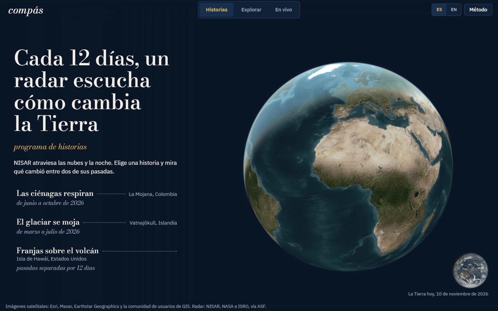
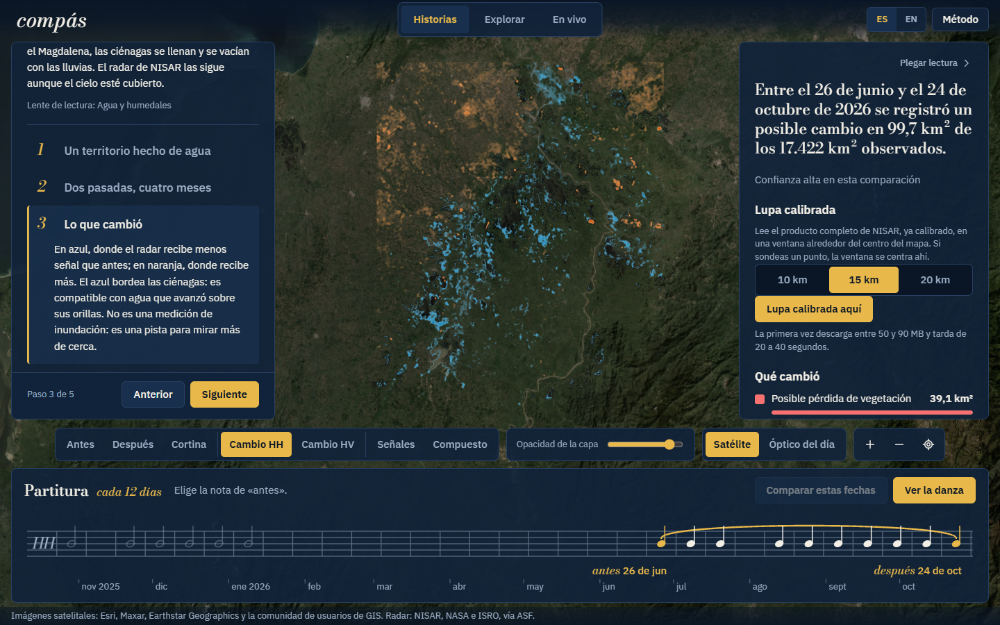
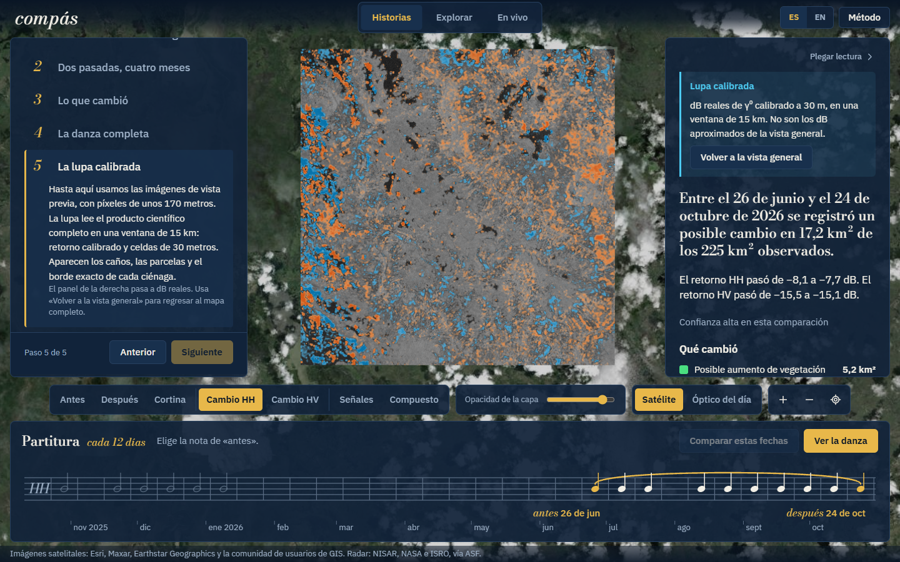
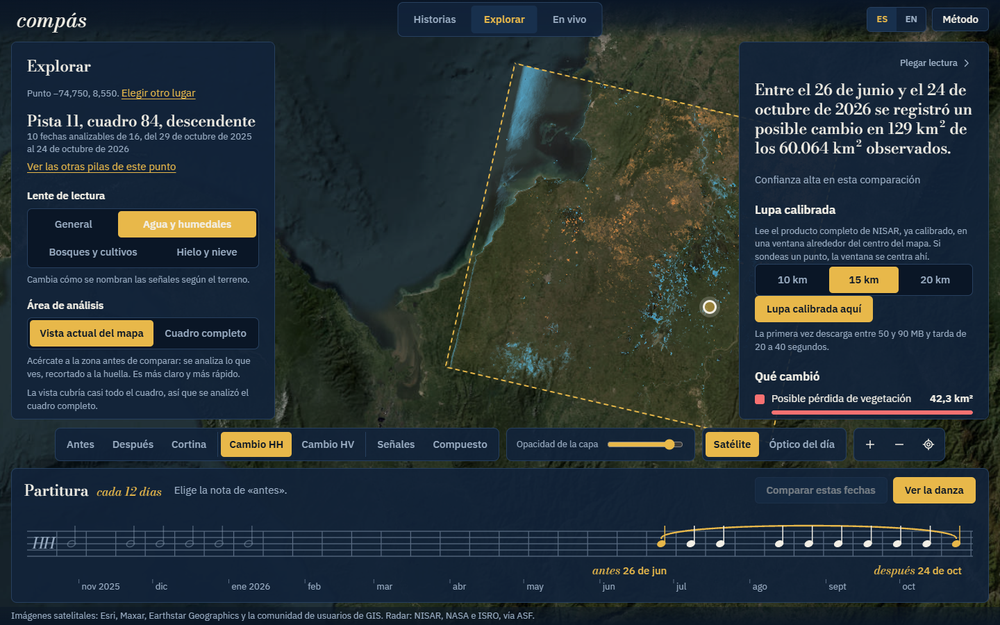

# Compás

Aplicación interactiva para el reto "Dancing with the SARs" del NASA Space Apps Challenge 2026. Muestra, con datos reales del radar NISAR (NASA e ISRO), qué cambió en la superficie de la Tierra entre dos pasadas del satélite, en cualquier lugar donde haya adquisiciones.

NISAR vuelve sobre cada sitio cada 12 días. Ese es el compás de la danza, y por eso la línea de tiempo de la aplicación es una partitura: cada pasada es una nota, y las dos que se comparan quedan unidas por una ligadura.



## Qué hace

- **Historias.** Tres recorridos guiados con datos reales: las ciénagas de La Mojana (Colombia) entre junio y octubre de 2026, el deshielo de verano del casquete Vatnajökull (Islandia) y los interferogramas sobre la isla de Hawái.
- **Explorar.** Un clic en cualquier punto del globo consulta el catálogo de NASA, lista las series de pasadas que cubren ese punto y permite comparar dos fechas.
- **Lectura del cambio.** Mapa de aumento y disminución del retorno del radar, clases de cambio con su área en km², sonda por punto, histograma, procedencia de cada dato y límites del análisis.
- **La danza.** Animación de todas las pasadas de una serie, con la partitura siguiendo el ritmo.
- **Lupa calibrada.** Con un token de Earthdata, lee una ventana del producto científico completo (retorno calibrado, celdas de 30 m) directamente desde la nube de NASA, sin descargar el archivo de 6 GB.
- **En vivo.** Eventos naturales recientes de NASA EONET y las últimas adquisiciones de respuesta urgente de NISAR, con acceso directo a explorar cada lugar.
- Interfaz en español e inglés. Cada vista tiene un enlace permanente.







## Datos

| Fuente | Uso | Acceso |
|---|---|---|
| NISAR GCOV, imágenes de vista previa (ASF DAAC) | Cambio entre fechas en todo el cuadro, a unos 170 m por píxel | Público |
| NISAR GCOV, producto HDF5 (ASF DAAC) | Lupa calibrada: γ⁰ a 10 m, promediado a 30 m | Token de Earthdata |
| NISAR GUNW, imágenes de vista previa | Interferogramas | Público |
| NISAR Urgent Response | Adquisiciones más recientes | Público |
| NASA CMR | Catálogo: fechas, huellas, pistas y cuadros | Público |
| NASA EONET v3 | Eventos naturales | Público |
| NASA EPIC (DSCOVR) | Imagen diaria de la Tierra | Clave de api.nasa.gov |
| NASA GIBS, VIIRS | Mapa base óptico del día | Público |
| Esri World Imagery | Mapa base satelital | Público |

No se usan datos sintéticos. Todo lo que aparece en pantalla viene de estos servicios.

## Método

El análisis general parte de las imágenes de vista previa que NASA publica con cada producto GCOV. Esas imágenes no guardan el retorno calibrado: cada una se recorta entre sus propios percentiles 5 y 95 y lleva una corrección gamma de 0,5. Lo confirmamos en el código fuente de `nisarqa` y en los metadatos de control de calidad de cada producto. Dos fechas, por tanto, no se pueden restar directamente.

Compás hace lo siguiente:

1. Invierte la gamma para obtener una magnitud proporcional a la potencia.
2. Suaviza el moteado con una media de 5×5 píxeles.
3. Ajusta una fecha a la escala de la otra con una regresión robusta de eje mayor reducido sobre los píxeles no saturados.
4. Recorta ambas fechas al intervalo en que las dos tienen información.
5. Calcula el cambio en decibelios aproximados y lo clasifica con un umbral de 3 dB.

El resultado es el cambio relativo al conjunto de la escena, no un valor calibrado. Por eso la aplicación dice "dB aproximados", rotula cada clase como "posible" y muestra un aviso de confianza cuando cambió gran parte de la escena.

La lupa calibrada no tiene esas limitaciones: lee γ⁰ del producto GCOV y calcula `10·log10(γ⁰₂/γ⁰₁)`.

### Validación

Comparamos el método de las imágenes de vista previa con el producto calibrado en una ventana de 15 km de La Mojana (26 de junio a 24 de octubre de 2026, 7.744 píxeles):

| Escala de comparación | Correlación | Mediana del error | Signo correcto |
|---|---|---|---|
| Alrededor de 1 km (la del método) | 0,86 | 0,7 dB | 100 % |
| 170 m | 0,49 | 0,8 dB | 94 % |

A escala de un kilómetro el método reproduce el patrón y el signo del cambio. A 170 m captura cerca de la mitad de la variabilidad y detecta pocos de los cambios fuertes. Es una sola ventana: sirve como evidencia orientativa, no como cifra general. Los números completos están en `docs/validacion-browse.json` y se reproducen con `scripts/validar_browse_vs_gcov.py`.

El detalle del método y de cada servicio está en `docs/contrato-api.md`.

### Lo que la herramienta no afirma

- No confirma inundaciones, incendios, deforestación ni deformación del terreno. Señala dónde cambió el retorno del radar y con qué es compatible.
- No es un sistema de alertas.
- Un interferograma sin corregir no mide deformación: la atmósfera y la ionosfera también dejan franjas.
- Solo compara fechas del mismo modo de adquisición. Mezclar modos produce franjas falsas.

## Cómo ejecutarlo

Requisitos: Python 3.11 o posterior, Node.js 20 o posterior, y conexión a internet.

```powershell
# 1. Claves (opcionales): copia la plantilla y complétala
Copy-Item .env.example .env

# 2. Instala, compila y abre http://127.0.0.1:8000
powershell -ExecutionPolicy Bypass -File scripts\start.ps1 -Prewarm
```

`-Prewarm` descarga y calcula las tres historias antes de abrir, para que respondan al instante durante una presentación.

Las dos claves de `.env` son opcionales:

- `NASA_API_KEY` (gratis en https://api.nasa.gov) activa la imagen diaria de la Tierra en la portada.
- `EARTHDATA_TOKEN` (gratis en https://urs.earthdata.nasa.gov/profile, pestaña Generate Token) activa la lupa calibrada. Caduca a los 60 días.

Sin ellas funciona todo lo demás. Ninguna clave llega al navegador: el servidor hace las peticiones.

### Modo desarrollo

```powershell
python -m pip install -r requirements.txt
npm install
python -m uvicorn backend.main:app --port 8000   # API
npm run dev                                      # interfaz en http://127.0.0.1:5173
```

### Pruebas

```powershell
python -X utf8 -m unittest discover -s tests   # backend, sin red
npm test                                       # interfaz
python -X utf8 scripts\smoke_backend.py        # backend contra los servicios reales
```

## Estructura

```
backend/    API FastAPI: catálogo, imágenes, método de cambio, series, lupa calibrada, eventos
src/        Interfaz React + TypeScript + MapLibre GL
data/       Historias (stories.json) y caché local (no se versiona)
docs/       Contrato de la API, dirección de diseño, validación y capturas
scripts/    Lanzador, precálculo, pruebas de humo, validación y prototipos
tests/      Pruebas del backend
```

La caché de `data/cache/` se limita sola a unos 3,5 GB; se puede borrar en cualquier momento.

## Uso de inteligencia artificial

El código y los textos de este proyecto se escribieron con asistentes de programación (Codex y Claude Code), dirigidos y revisados por el autor. Los asistentes no generaron ningún dato: las imágenes, cifras y fechas provienen de los servicios de NASA y ASF citados arriba, y cada resultado se puede reproducir con los scripts del repositorio.

## Créditos

Datos de NISAR por cortesía de NASA, ISRO y el Alaska Satellite Facility DAAC. Eventos de NASA EONET. Imagen diaria de NASA EPIC. Teselas de NASA GIBS y de Esri (Esri, Maxar, Earthstar Geographics y la comunidad de usuarios de GIS). Proyecto independiente: no es un producto oficial de NASA ni de ISRO.

## English summary

Compás is an interactive web app for the "Dancing with the SARs" challenge. It uses real NISAR radar data to show what changed on the ground between two satellite passes anywhere acquisitions exist. Pick a guided story or click any point on the globe, choose two dates on a timeline drawn as a musical score (one note per 12-day pass), and read the change map, class areas, per-point probe, provenance and limits. With an Earthdata token, a calibrated lens reads a window of the full GCOV science product (γ⁰, 30 m cells) straight from NASA's cloud. The general method works on the public preview images with a robust cross-date normalization; it was checked against the calibrated product (correlation 0.86 at the 1 km scale, 0.49 at 170 m, one 15 km window). The interface is available in Spanish and English.
