**English** · [Español](README.es.md)

# SARitmo

An interactive app for the "Dancing with the SARs" challenge at the NASA Space Apps Challenge 2026. Using real NISAR radar data from NASA and ISRO, it shows what changed on Earth's surface between two satellite passes, anywhere acquisitions are available.

NISAR's nominal repeat cycle is 12 days; available acquisitions may have gaps. That is the beat of the dance, which is why the timeline is a musical score: each observation is a note, and the actual interval between dates is shown.

**New saved walkthrough:** `/?demo=mojana`, with a calibrated window, HH/HV listening, an evidence record and a printable HTML report. See [preparation, testing without external services and restoring the backup](docs/demo.md) and [improvement status](docs/estado-mejoras-2026-11-14.md).

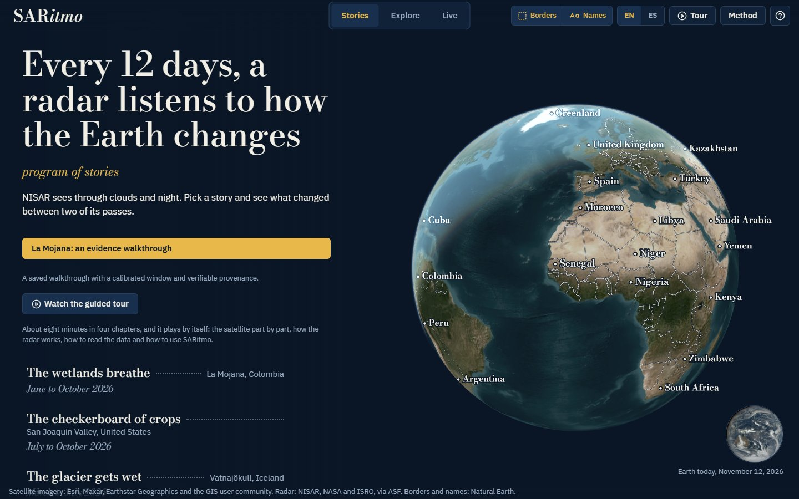

## What it does

- **Stories.** Four guided journeys using real data: the wetlands of La Mojana (Colombia) between June and October 2026, agricultural fields in the San Joaquin Valley (United States) between summer and harvest, summer melt on Iceland's Vatnajökull ice cap, and interferograms over the island of Hawaii.
- **Why it changed.** Each change class includes its physical hypothesis, other possible causes and the polarization that reveals it.
- **Context.** Optional NASA layers enabled with one click on the map toolbar: **Water**, surface water seen by Sentinel-1 (another radar, operating in C band); **Forests and land**, land cover; and **Population**, population density. Each enabled layer keeps its legend visible.
- **Explore.** Click anywhere on the globe, or search for a city or address, to query NASA's catalog, list the pass series covering that point and compare two dates.
- **Reading the change.** A map of increases and decreases in radar return, change classes with their area in km², a point probe, a histogram, data provenance and analysis limitations.
- **The dance.** A color animation of every pass in a series (lilac where HH dominates, green where HV dominates), with the musical score following the rhythm. Each note sounds at its displayed pitch: stronger radar return means a higher note. The speaker on the score (or the M key) mutes it.
- **Calibrated lens.** With an Earthdata token, it reads a window from the full scientific product in NASA's cloud. It obtains pixel spacing from the metadata and averages in power; the prepared La Mojana case uses 30 m cells.
- **Live.** Recent natural events from NASA EONET and the latest NISAR urgent response acquisitions, with direct access to explore each location. **NISAR now** shows the satellite in 3D, to scale, at its current position, the swath about 150 mi wide that its radar can see to the left of its heading, and its next orbit, calculated from CelesTrak orbital elements. The satellite's altitude is 464 mi. The swath was checked against the actual footprint of a pass over La Mojana.
- **Tour.** About 8.5 minutes, 31 steps and four chapters that advance automatically and can be paused: **The satellite**, piece by piece with a rotatable 3D model; **The radar**, covering orbit, side-looking geometry, echoes, surfaces, HH and HV with animated diagrams; **The data**, covering **Before**, **After**, **Curtain**, **HH change**, **HV change**, **Signals**, **Composite**, the reading, point measurements and all three context layers; and **The app**, showing how to use it. The app performs each action as the tour explains it. Open **Tour** from the top bar, the cover, **NISAR now** or help.
- **NISAR model.** Built piece by piece from NASA/JPL's public-domain front and side views and published measurements: a 39 ft reflector with a 30-segment ring, a 30 ft boom, an 18 ft body with the eight-sided radar structure, L- and S-band feeds, 18 ft solar wings and a Ka-band antenna. A person 5 ft 9 in tall provides scale. NASA does not offer a downloadable NISAR 3D model; supports and minor details are approximate.
- **Units.** The Spanish UI uses metric units. In English, satellite and orbit dimensions use feet and miles; scientific data (km², dB) retain the units supplied by NISAR.
- **Boundaries and names.** Country borders, state or department boundaries, and place names with their points are drawn over the data. Toggle them from the top bar (B and N keys).
- **Help and shortcuts.** The help button (? key) explains the workflow in three steps and lists keyboard shortcuts. A dismissible map hint suggests the next action in each view.
- English and Spanish UI. It opens in English; switch languages in the top bar (or use `#lang=es` in the link), and the choice is remembered. Every view has a permanent link.

The satellite chapter shows the spacecraft's dimensions and highlights its individual parts.

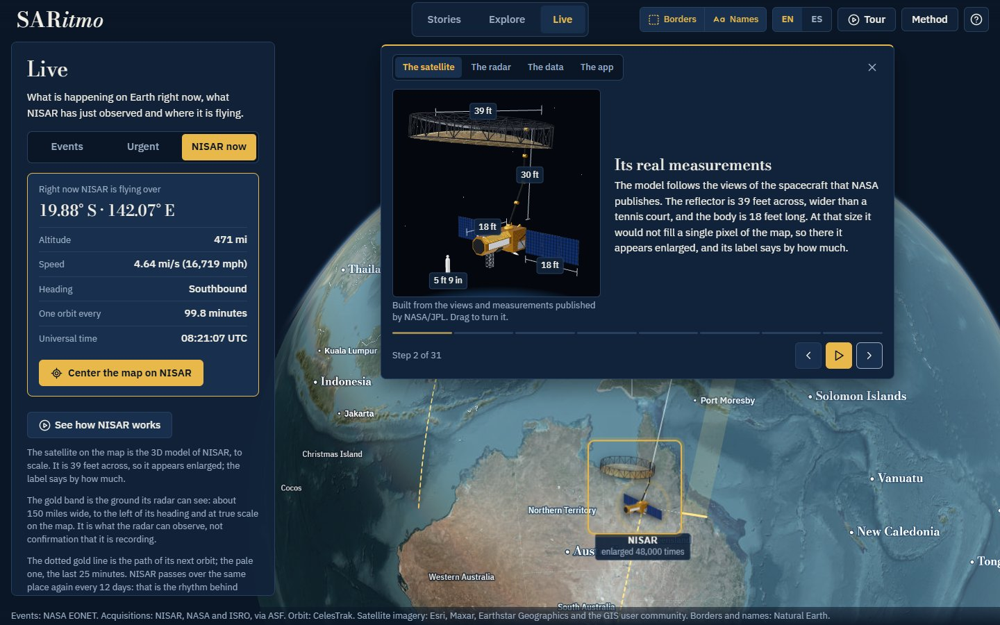

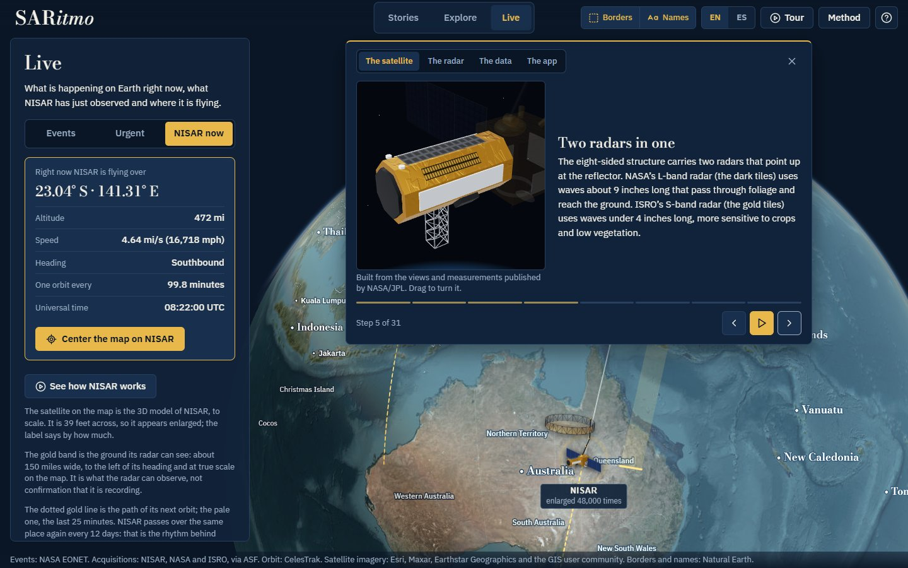

The radar chapter explains side-looking geometry and the HH/HV channels.

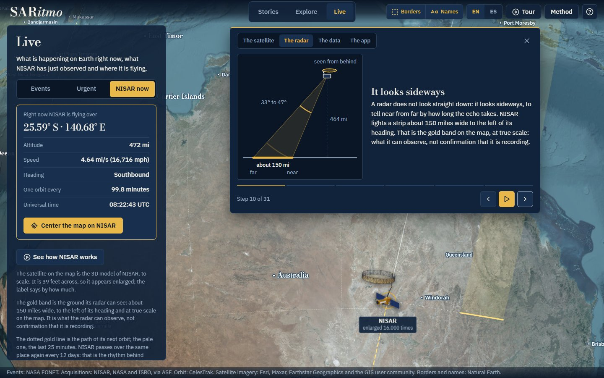

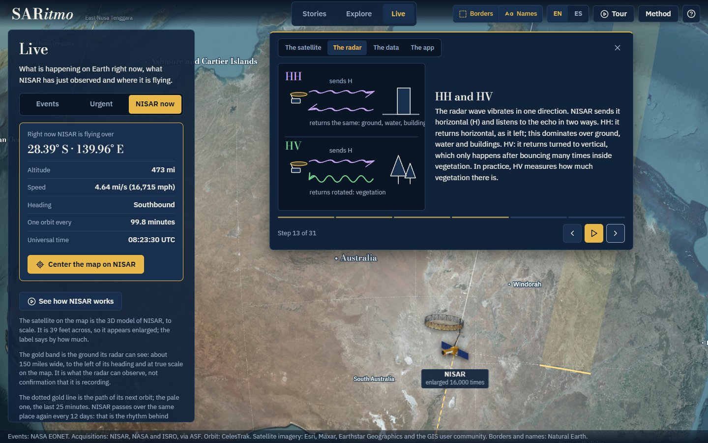

La Mojana combines the radar change map with a reading panel; **Signals** brings the possible physical interpretations onto the map.

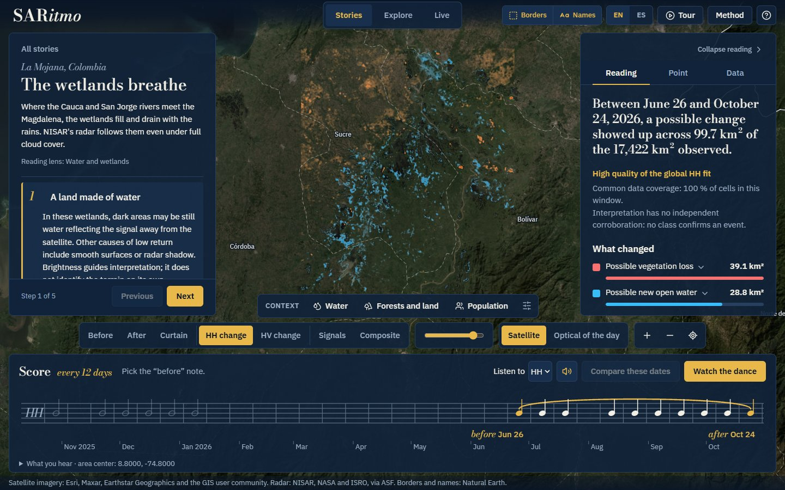

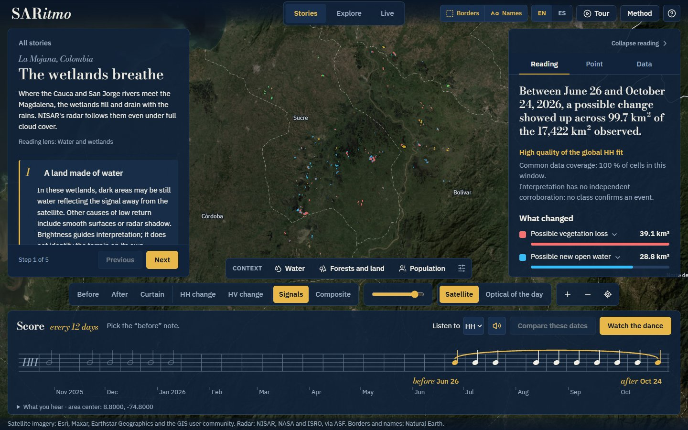

Zoom out to compare the radar footprint with **Forests and land** context across the globe.

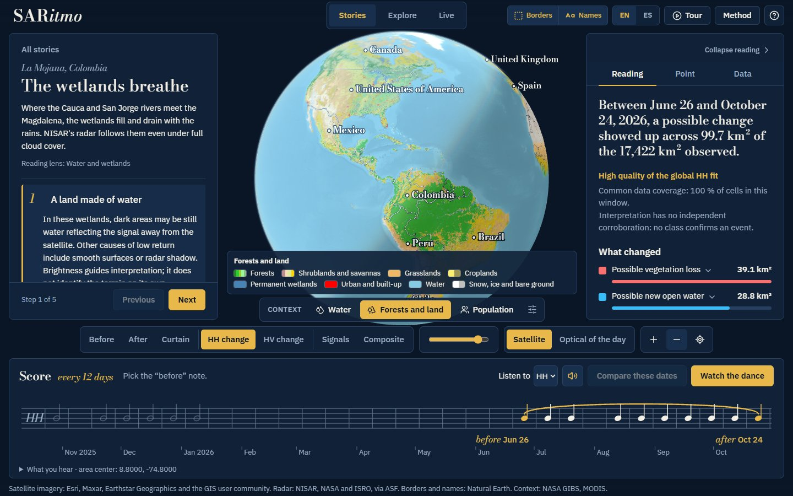

**Explore** opens the same workflow for any place with NISAR acquisitions. **Live** includes **NISAR now**, also shown in the first tour step.

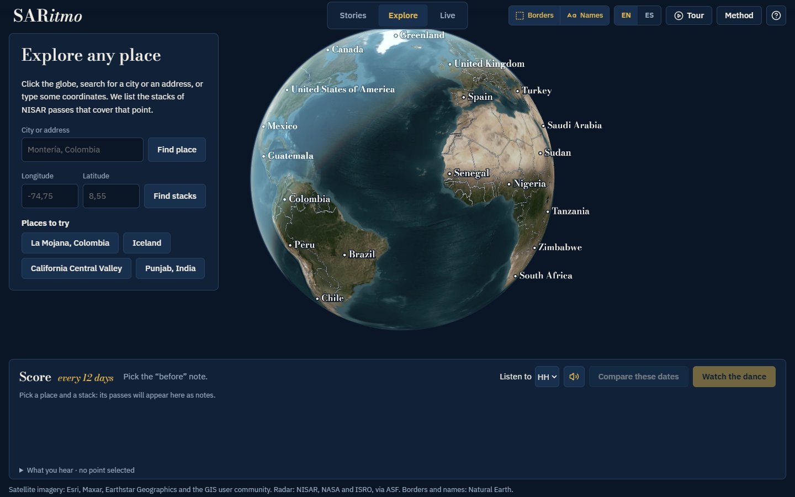

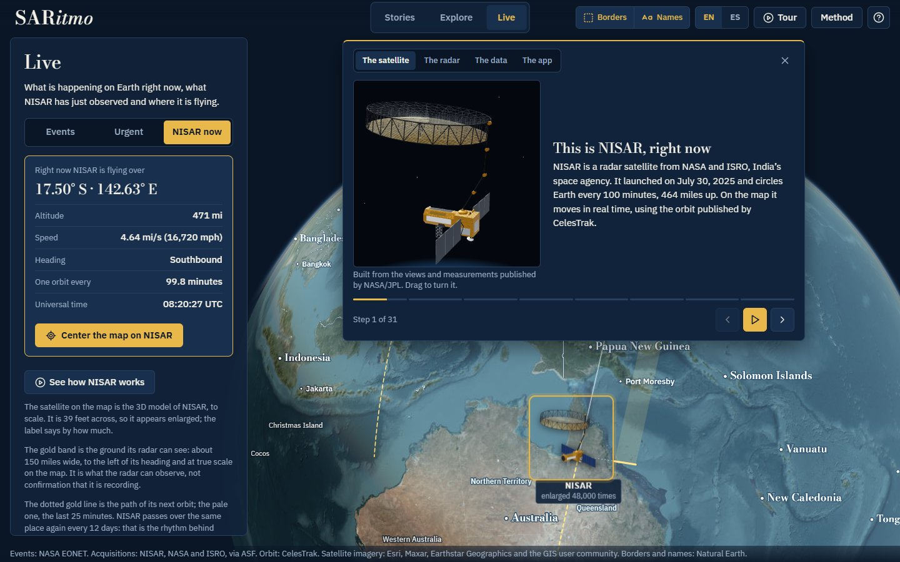

The tour is also available on mobile.

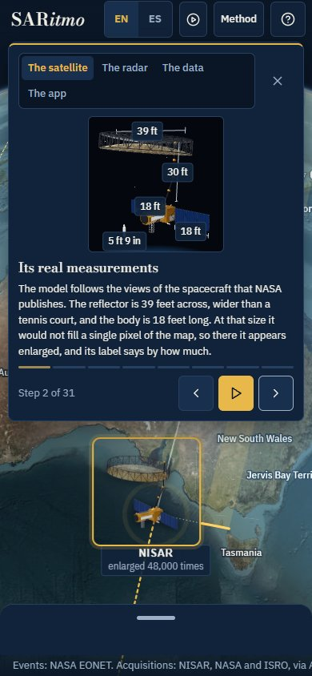

## Data

| Source | Use | Access |
|---|---|---|
| NISAR GCOV preview images (ASF DAAC) | Change between dates across the whole frame, at about 170 m per pixel | Public |
| NISAR GCOV HDF5 product (ASF DAAC) | Calibrated lens: γ⁰ at 10 m, averaged to 30 m | Earthdata token |
| NISAR GUNW preview images | Interferograms | Public |
| NISAR Urgent Response | Most recent acquisitions | Public |
| NASA CMR | Catalog: dates, footprints, tracks and frames | Public |
| NASA EONET v3 | Natural events | Public |
| NASA EPIC (DSCOVR) | Daily Earth image | api.nasa.gov key |
| NASA GIBS, VIIRS | Daily optical basemap | Public |
| NASA GIBS, OPERA DSWx-S1 | Surface water seen by Sentinel-1 (C band): independent comparison | Public |
| NASA GIBS, MODIS IGBP | Land cover | Public |
| NASA GIBS, GPW 2020 | Population density | Public |
| Esri World Imagery | Satellite basemap | Public |
| OpenStreetMap Nominatim | City and address search in Explore | Public |
| CelesTrak (NISAR orbital elements, NORAD 65053) | Satellite position in NISAR now, calculated with the SGP4 model | Public |
| Natural Earth | Borders, internal boundaries and names on the map (files in `public/ref/`) | Public domain |

No synthetic data are used. Everything displayed comes from these services. Place search only converts a name to coordinates; the radar data still come from NISAR.

### Challenge resources

The challenge proposes fourteen open resources. This table describes each one's role in SARitmo; the same list appears in the app's **Method** dialog.

| Resource | Role in SARitmo |
|---|---|
| [Earthdata Search](https://search.earthdata.nasa.gov/search) | The same catalog (CMR) the backend queries to list passes |
| [ASF Data Search](https://search.asf.alaska.edu/) | Source of NISAR products; each comparison links to both product records |
| [NISAR documentation](https://nisar-docs.asf.alaska.edu/) | GCOV and GUNW specifications; cited in the stories |
| [Remote sensing basics](https://www.earthdata.nasa.gov/learn/earth-observation-data-basics/remote-sensing) | Reference reading |
| [What is synthetic aperture radar?](https://www.earthdata.nasa.gov/learn/earth-observation-data-basics/sar) | Basis for the physical hypotheses: bands, polarization and interferometry |
| [ARSET training](https://appliedsciences.nasa.gov/get-involved/training) | Courses for further study, including two involving NISAR |
| [NISAR StoryMaps](https://nisar.jpl.nasa.gov/applications/arcgis-storymaps/) | Story context: flooding, ice and subsidence |
| [NISAR societal benefits](https://nisar.jpl.nasa.gov/applications/societal-benefit/) | Background reading by application |
| [UAVSAR postcards](https://uavsar.jpl.nasa.gov/education/postcards.html) | Airborne L-band predecessor; two postcards match stories (Kilauea and Vatnajökull) |
| [RCM](https://donnees-data.asc-csa.gc.ca/en/dataset/rcm) (CSA) | Reference: C-band radar for comparison. Not processed in the app |
| [SAR tutorial](https://github.com/asc-csa/Synthetic_Aperture_Radar_Tutorial) (CSA) | Reference for opening RADARSAT images in QGIS and Python |
| [RADARSAT-1 archive](https://donnees-data.asc-csa.gc.ca/en/dataset/radarsat1) (CSA) | Reference: C-band data from 1995 to 2013. Not processed in the app |
| [SAOCOM catalog](https://catalogos.conae.gov.ar/catalogo/catalogoSatSaocomInfo.html) (CONAE) | Reference: L band, like NISAR. Not processed in the app |
| [SAOCOM archive access](https://www.argentina.gob.ar/noticias/la-informacion-saocom-cada-vez-mas-accesible) (CONAE) | Access conditions: registration and a license, Argentine territory only |

## Method

The overview analysis starts with the preview images NASA publishes alongside each GCOV product. These images do not preserve calibrated radar return: each is clipped to its own 5th and 95th percentiles and gamma-corrected with an exponent of 0.5. We confirmed this in the `nisarqa` source code and each product's quality-control metadata. Two dates therefore cannot be subtracted directly.

SARitmo performs these steps:

1. Reverses gamma to recover a quantity proportional to power.
2. Smooths speckle with a 5×5-pixel mean.
3. Fits one date to the other's scale using robust reduced major axis regression over unsaturated pixels.
4. Clips both dates to the interval where both contain information.
5. Computes change in approximate decibels and classifies it using a 3 dB threshold.

The result is change relative to the scene as a whole, not a calibrated value. The app says "approximate dB" and labels every class "possible". It reports fit quality, data coverage and interpretation support separately: a good fit does not confirm a flood.

The calibrated lens reads γ⁰ from the GCOV product and computes `10·log10(γ⁰₂/γ⁰₁)` without a global fit. It remains subject to geometry, noise, coverage and physical ambiguity. The possible flooded vegetation rule requires HH ≥ +3 dB and HV between −1.5 and +1.5 dB, as well as a non-dark HH return before the change; a strong HV drop no longer satisfies this rule.

### Validation

The November 14, 2026 run compares three combinations of area and dates, HH/HV, and thresholds of 2, 3 and 4 dB. For the main 15 km window in La Mojana (June 26 to October 24, 2026, 7,744 common pixels), HH at 3 dB gives:

| Reference | Correlation | Median absolute error | Precision | Recall |
|---|---|---|---|---|
| Aggregated to ~170 m | 0.517 | 0.78 dB | 50.0% | 12.2% |
| Additional 5×5 mean (~1 km) | 0.861 | 0.69 dB | 12.5% | 45.0% |

In the second row, 9 of 72 browse detections and 20 reference detections overlap: the 100% correct sign refers only to those 9 matches. In another window, HH has a correlation of 0.471 at the smoothed scale and no matches at the threshold. The consecutive-date pair has few strong changes and cannot support a precision estimate when there are no detections. Correlation is not detection accuracy; smoothed pixels are not independent samples, and GCOV is not ground truth. The physical classes still lack independent validation. See [all results and limitations](docs/validacion-ampliada.md) and the [reproducible JSON](docs/validacion-multiventana-2026-11-14.json). Historical results are retained.

Details of the method and each service are in `docs/contrato-api.md`.

### How to check a result yourself

- **Provenance.** Each comparison lists the names of both products. Search for them at https://search.asf.alaska.edu to see the same images published by NASA.
- **Temporal control.** Compare consecutive passes and check for external evidence of stability. Real changes can also occur within twelve days.
- **Two orbits.** Review the same period from both viewing geometries when data are available; observation differences can change the response. Agreement is additional evidence, not a guaranteed condition.
- **Another radar.** Enable the Sentinel-1 Water layer and compare it with the NISAR change.
- **Another sensor.** Review the same dates in optical imagery at https://worldview.earthdata.nasa.gov.
- **Calibrated data.** Open the lens over the area, or run `scripts/validar_browse_vs_gcov.py`.
- **Field evidence.** None of these checks replaces information collected on the ground: river levels, local reports or agricultural surveys.

### What the tool does not claim

- It does not confirm floods, fires, deforestation or ground deformation. It indicates where radar return changed and what that change is consistent with.
- It is not an alert system.
- An uncorrected interferogram does not measure deformation: the atmosphere and ionosphere also produce fringes.
- It only compares dates with the same acquisition mode. Mixing modes produces false stripes.

## How to run

Requirements: Python 3.11 or later, Node.js 20 or later, and an internet connection.

```powershell
git clone https://github.com/Gxxrazn21/compas-nisar
cd compas-nisar

# 1. Keys (optional): copy the template and fill it in
Copy-Item .env.example .env

# 2. Install, build and open http://127.0.0.1:8000
powershell -ExecutionPolicy Bypass -File scripts\start.ps1 -Prewarm
```

`-Prewarm` downloads and computes all four stories before opening, so they respond immediately during a presentation.

Both keys in `.env` are optional:

- `NASA_API_KEY` (free at https://api.nasa.gov) enables the daily Earth image on the cover.
- `EARTHDATA_TOKEN` (free at https://urs.earthdata.nasa.gov/profile, Generate Token tab) enables the calibrated lens. It expires after 60 days.

Everything else works without them. No key reaches the browser: the server makes the requests.

### Development mode

```powershell
python -m pip install -r requirements.txt
npm install
python -m uvicorn backend.main:app --port 8000   # API
npm run dev                                      # UI at http://127.0.0.1:5173
```

### Tests

```powershell
python -X utf8 -m unittest discover -s tests   # backend, offline
npm test                                       # UI
python -X utf8 scripts\smoke_backend.py        # backend against live services
```

### Keyboard shortcuts

| Key | Action |
|---|---|
| 1, 2, 3 | Stories, Explore, Live |
| ← → | Previous or next story step |
| D | Start or leave the dance |
| Space | Pause or resume the dance |
| M | Note sound |
| B, N | Boundaries, names |
| + − 0 | Zoom in, zoom out, return to the area |
| ? | Help |

Shortcuts are inactive while typing in an input field.

### Map reference data

`public/ref/` stores simplified borders, internal boundaries and names. To regenerate them from Natural Earth (requires `shapely`):

```powershell
python -X utf8 scripts\build_reference.py
```

## Explainer video

The `video/` directory generates a 92-second video (1920 × 1080) showing the app in use, in English and Spanish. It does not use manual screenshots: it records the real app with Chrome and places the footage in an animated composition.

```powershell
# With the app running at http://127.0.0.1:8000
node video\capture.mjs en          # record app shots (repeat with "es")
python -X utf8 video\music.py      # background track generated by synthesis
node video\render.mjs en --audio video\out\music.wav   # video\out\compas-en.mp4
```

Requires Google Chrome and ffmpeg. Scene text and timing are in `video/composition/script.js`. Shots and MP4 files are not tracked in Git.

## Structure

```
backend/    FastAPI API: catalog, images, change method, series, calibrated lens, events
src/        React + TypeScript + MapLibre GL UI
data/       Stories (stories.json) and local cache (not tracked in Git)
docs/       API contract, design direction, validation and screenshots
scripts/    Launcher, precomputation, smoke tests, validation and prototypes
video/      Explainer video: app recording, animated composition and rendering
tests/      Backend tests
```

The `data/cache/` cache automatically limits itself to about 3.5 GB; it can be deleted at any time.

## Use of AI

This project's code and text were written with coding assistants (Codex and Claude Code), directed and reviewed by the author. The assistants did not generate any data: images, figures and dates come from the NASA and ASF services cited above, and every result can be reproduced with the repository's scripts.

The voice-over of the 30-second demo video is AI-generated: a text-to-speech model (Kokoro, run locally by `video/voice.py`) reads the on-screen captions. The video's music is synthesized by `video/music.py`, and its footage is a recording of the real app.

## License

Code is licensed under MIT (see `LICENSE`). Data belong to their respective sources and are used according to their open-access policies.

## Credits

NISAR data courtesy of NASA, ISRO and the Alaska Satellite Facility DAAC. Events from NASA EONET. Daily image from NASA EPIC. Tiles from NASA GIBS and Esri (Esri, Maxar, Earthstar Geographics and the GIS user community). Place search by Nominatim, © OpenStreetMap contributors. NISAR orbital elements from CelesTrak; position calculated with satellite.js (SGP4). NISAR 3D model built with three.js from NASA/JPL reference sheets. Borders and names from Natural Earth (public domain). An independent project: not an official NASA or ISRO product.
